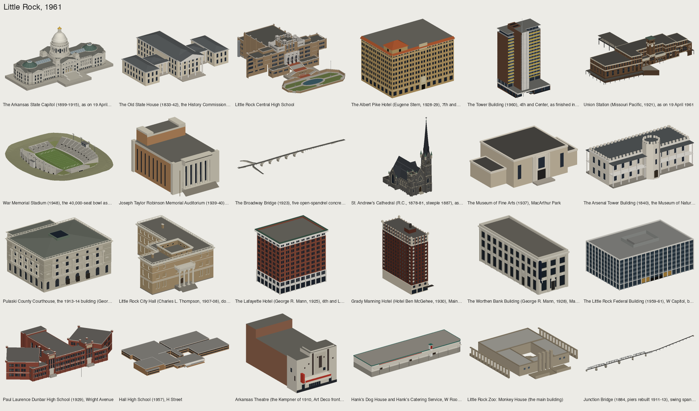
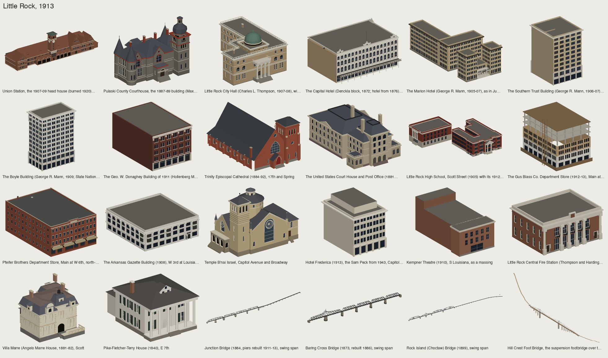
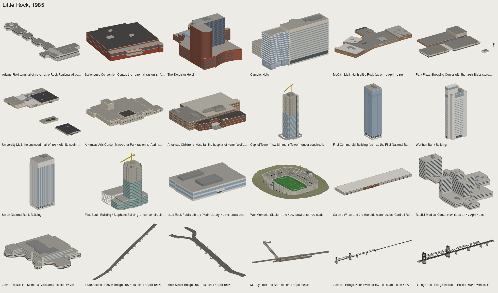
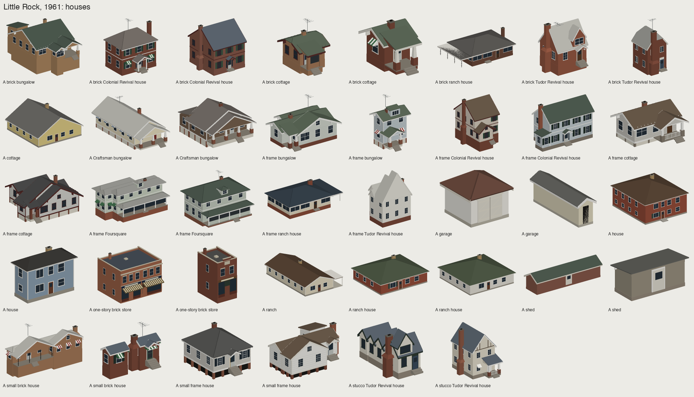

# Little Rock buildings

3D models of buildings in Little Rock and North Little Rock, Arkansas, the way they stood in 1913, 1961 and 1985. 541 models, all glTF.

I'm building a city sim of Little Rock through the years. These are the buildings I've made for it so far. They seemed worth putting out on their own.

## What's in here

| Folder | What | Models |
|---|---|---|
| `1913/landmarks` | churches, schools, hotels, banks, stores, public buildings | 144 |
| `1913/structures` | the three railroad bridges and a footbridge | 4 |
| `1961/landmarks` | the same kinds of buildings, plus the Capitol, the stadium and the zoo | 184 |
| `1961/structures` | four river bridges and the piers of the old footbridge | 5 |
| `1961/houses` | a sample of houses, with a few garages, sheds and stores | 38 |
| `1985/landmarks` | towers, malls, hospitals, schools, churches, the airport | 160 |
| `1985/structures` | five river bridges and Murray Lock and Dam | 6 |

Each year is really one day: 15 June 1913, 19 April 1961 and 17 April 1985. A model shows the building the way it was on that day, as best I could work out.

A few things to know:

- The same building can be in here more than once if it changed. Union Station is here twice, the 1907 one that burned and the 1921 one that replaced it.
- A building that didn't change is only in here once, in the first year it shows up.
- There's no 1939 folder. My 1939 city uses the 1913 and 1961 models that were standing then. The `stands_in` column in the catalog says which years each model is good for.
- The sim has a couple thousand more houses. Most of them come from the same house kit, so I only put a sample here.

## How they were made

Every model is built by a script. The shape of the building is written out in Python and exported to glTF, through Blender for the landmarks. Nothing was sculpted by hand.

Where the shapes come from:

- **Footprints:** Sanborn fire insurance maps (the 1913 and 1950 sheets), old aerial photos (1943, 1960, 1970 and 1983), the City's building outlines for the newer buildings, and OpenStreetMap for a few.
- **Heights:** the story counts on the Sanborn maps, and lidar for most of the 1985 buildings.
- **Fronts, roofs, windows and colors:** worked out from old photos and postcards, National Register write-ups, and what's still standing. The photos were only something to look at. None of them are in the files.

Some models are solid and some are guesses. If I couldn't find a picture of a building, it's a plain building of the right kind on the right footprint. Those are marked `low` in the `confidence` column.

Models marked `kit` in the `method` column weren't done one at a time. A kit builds a house (or a small bank, school, church or store) of a given type on the real footprint. The footprint and the number of stories are real. The porch, roof and windows are the kit's.

They're not super detailed. Flat colors, no textures.

## The files

- glTF 2.0 binary (`.glb`), one building per file, nothing external. The biggest file is under 1 MB and the whole set is about 100 MB.
- Units are meters. Y is up.
- On a building, the front faces +Z. The origin is in the middle of the footprint, with the first floor at y = 0. Foundations go below zero so a building can sit on a slope.
- Bridges are different. The origin is a point on the bridge, not always the middle, and y = 0 is that bridge's own reference height, not the ground or the water. Piers go well below it.
- No textures, no images, no UVs. Color comes from each material's base color, or from vertex colors on 190 of the models.
- Positions, normals and indexed triangles. Half the models are under 2,200 triangles. The biggest is about 21,000.
- One level of detail. No LODs.
- The three lift bridges in `1985/structures` have a morph target called `raised` that lifts the span.

## Opening them

Any glTF viewer works. Drag a file onto [gltf-viewer.donmccurdy.com](https://gltf-viewer.donmccurdy.com) or [sandbox.babylonjs.com](https://sandbox.babylonjs.com). In Blender it's File > Import > glTF 2.0.

## The catalog

`models.csv` and `models.json` list every model. Same data in both.

| Column | What it is |
|---|---|
| `id` | the file name without `.glb` |
| `name` | what the building is |
| `era` | the year folder it's in: 1913, 1961 or 1985 |
| `stands_in` | which of my four years (1913, 1939, 1961, 1985) the model is used in |
| `built` | when it was built, if I know |
| `kind` | `landmark`, `structure`, `house`, `outbuilding` or `shop` |
| `method` | `modeled` (its own script), `kit` (a kit on the real footprint) or `spec` (the house builder, from a short description of the house) |
| `confidence` | `low` or `medium` when a lot of it is a guess. Blank is normal. |
| `style` | the type of house. Houses only. |
| `lon`, `lat` | where the model's origin goes. Landmarks and structures only. Houses don't have them, and neither do a few landmarks that are somebody's home. |
| `heading` | the compass direction the front (+Z) faces, in degrees clockwise from north |
| `elev_m` | for some of the bridges, the height of y = 0 above sea level, in meters. Blank for everything else. |
| `plan_source` | where the footprint came from: `sanborn`, `aerial-1960`, `aerial-1983`, `aerial`, `usgs-quad-1961`, `city-outline`, `osm` or `osm+city-outline` |
| `osm` | `yes` if the model uses OpenStreetMap data |
| `triangles`, `bytes` | size of the model |
| `file` | path to the `.glb` |

## Previews

`previews/` has contact sheets rendered straight from the models. One sheet per year, one for the houses, and every single model in `previews/all/`.

## License

[CC BY 4.0](LICENSE). Use them for whatever you want, just credit Matt Vandenberg.

## Credits

What the models were worked out from:

- Sanborn Fire Insurance Maps of Little Rock, from the Library of Congress
- City of Little Rock aerial photo mosaics (1943, 1960, 1970) and building outlines
- USDA NHAP aerial photography from 1983, from the Arkansas GIS Office
- USGS topographic maps and 3DEP lidar, and Pulaski Area GIS lidar
- National Register of Historic Places nominations and the Encyclopedia of Arkansas, for dates and descriptions
- OpenStreetMap, for 21 of the models (the ones with `yes` in the `osm` column). © OpenStreetMap contributors, available under the [Open Database License](https://www.openstreetmap.org/copyright).
